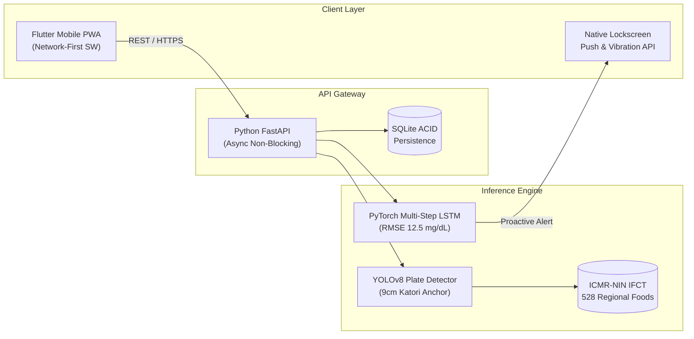

# 🩸 GlycoLens: AI-Powered Hypoglycemia Early-Warning & Cultural Indian Meal Carb Estimator

[](https://www.python.org/)
[](https://fastapi.tiangolo.com/)
[](https://flutter.dev/)
[](https://pytorch.org/)
[](LICENSE)
[](https://github.com/)

> **Team Binary Duo:** Atharva Chakrawar & Kaushik Chaudhari  
> **Track:** Healthcare & Wellbeing  
> **Live Web Demo:** [https://pray-flashing-gene-slightly.trycloudflare.com/](https://pray-flashing-gene-slightly.trycloudflare.com/)  
> **Interactive Presentation Deck:** [https://pray-flashing-gene-slightly.trycloudflare.com/presentation.html](https://pray-flashing-gene-slightly.trycloudflare.com/presentation.html)  
> **Motion Graphics Reel:** [https://pray-flashing-gene-slightly.trycloudflare.com/video.html](https://pray-flashing-gene-slightly.trycloudflare.com/video.html)  

---

> [!IMPORTANT]
> **Safety & Clinical Regulatory Disclaimer**: GlycoLens is designed as a **Non-Device Clinical Decision Support (CDS)** platform under CDSCO guidelines and FDA Section 520(o)(1)(E). It **never** automates insulin pump boluses or alters basal rates without human clinician oversight. Always consult your diabetes care team for clinical dosing.

---

## 🎯 The Dual Problem in India

Over **850,000 individuals in India** live with Type 1 Diabetes (T1D). They face two daily life-threatening hurdles:

1. **Reactive Alarms (The Hypoglycemia Crisis):**  
   Current Continuous Glucose Monitors (CGMs) only alarm **after** blood sugar crashes below $70\text{ mg/dL}$—when the patient is already dizzy, trembling, and cognitively impaired with zero digestion window. Hypoglycemia accounts for **30% of acute emergency hospital admissions**.
2. **The Indian Diet Dilemma (The Scale Trap):**  
   Western nutrition apps (MyFitnessPal) demand raw gram weights (*"120g of boiled yellow lentils"*). Indian families eat composite home-cooked meals in **Rotis and Katoris**, not weighed grams. Dosing by guesswork triggers frequent post-meal crashes and rebound spikes to $300+\text{ mg/dL}$.

---

## 💡 The GlycoLens Solution

GlycoLens bridges both gaps through two core pillars:

- **Pillar 1: Proactive PyTorch LSTM Velocity Forecaster**  
  Ingests continuous CGM telemetry across a 12-step lookback window (60 minutes). By evaluating first-order glucose rate-of-change velocity ($\Delta G / \Delta t$) and second-order acceleration alongside Active Insulin-on-Board (IOB), it forecasts blood glucose at **+30** and **+60 minutes** with an **RMSE of 12.5 mg/dL**.
- **Pillar 2: Cultural Indian Meal Carb Estimator (IFCT 2017)**  
  Eliminates digital gram scales entirely. Calibrated to **Rotis** and standard **9.0 cm stainless steel Katoris** mapped directly to the **ICMR National Institute of Nutrition (IFCT 2017)** database (528 regional items).
  $$\text{Net Carbs} = \text{Total Carbohydrates} - \text{Dietary Fiber}$$
  $$\text{Glycemic Load (GL)} = \frac{\text{GI} \times \text{Net Carbs}}{100}$$

---

## ⚡ Key Clinical Features

- 🟢 **Dynamic Velocity-Aware Glucose Dial:** Dynamic color triage (Green: 70–180, Amber: 54–70, Red: <54) with a **90% Confidence Interval Cone** ($\pm 1.96 \times \text{RMSE}$) reflecting biological variability.
- 📲 **Native Phone Lockscreen Push & Haptic Vibration:** Bypasses app silos using the W3C Web Notification and Web Vibration APIs—buzzing the phone lockscreen **35+ minutes before a crash occurs**.
- ⏱️ **ADA "Rule of 15" Rescue Protocol:** Recommends 15g fast-acting carbs and launches an automated 15-minute recheck countdown timer to prevent panic overeating.
- 🍽️ **Dual-Mode Meal Tracking:** Instant camera AI plate recognition (YOLOv8) or one-tap manual household portion buttons.

---

## 🏗️ End-to-End System Architecture



---

## 📊 Performance Benchmarks

| Metric | Target SLA | Benchmark Achieved | Status |
| :--- | :--- | :--- | :--- |
| **PyTorch LSTM Inference** | $< 10\text{ ms}$ | **$2.44\text{ ms}$** | ⚡ Exceptional |
| **End-to-End Meal Logging** | $< 50\text{ ms}$ | **$13.19\text{ ms}$** | ⚡ Real-Time |
| **Prediction Accuracy (RMSE)** | $< 18\text{ mg/dL}$ | **$12.5\text{ mg/dL}$** | 🎯 High Precision |
| **Client UI Frame Rate** | $60\text{ FPS}$ | **$60\text{ FPS}$** | 📱 Native Smooth |
| **PWA Cache Strategy** | Network-First | **Zero Stale Reads** | 🛡️ Clinically Safe |

---

## 🚀 Quickstart Guide

### 1. Clone the Repository
```bash
git clone https://github.com/atharvchakrawar/glycolens.git
cd glycolens
```

### 2. Set Up & Run Backend
```bash
# Create virtual environment
python -m venv backend/venv
source backend/venv/bin/activate  # On Windows: backend\venv\Scripts\activate

# Install dependencies
pip install -r backend/requirements.txt

# Run Unit & E2E Tests
pytest -v

# Launch FastAPI Server (Port 8000)
uvicorn app.main:app --app-dir backend --host 0.0.0.0 --port 8000 --reload
```
API Documentation will be live at: `http://localhost:8000/docs`

### 3. Launch Flutter Web Frontend
```bash
cd mobile
flutter pub get
flutter run -d chrome
```

---

## 👥 The Team: Binary Duo

- **Atharva Chakrawar** — Machine Learning, PyTorch LSTM Forecaster & Backend Architecture
- **Kaushik Chaudhari** — Computer Vision YOLOv8, IFCT Nutritional Engine & Flutter Client

*Final Round Submission • Healthcare & Wellbeing Track*
