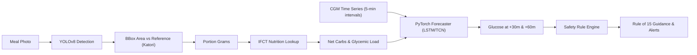

# GlycoLens Architecture & System Design

## 1. System Overview

**GlycoLens** is a decision-support prototype designed for Type 1 diabetes (T1D) self-management. It combines:
1. **Computer Vision & Nutritional Chemistry**: Detects Indian meal items and portions relative to standard reference objects (katori/thali plate) and derives net carbs, fiber, and glycemic load using the ICMR Indian Food Composition Tables (IFCT 2017).
2. **Glucose Forecasting & Early Warning**: Takes recent continuous glucose monitor (CGM) streams, active insulin units, and confirmed carbs to predict future trajectory at +30 and +60 minutes.
3. **Safety Engine & Rule-of-15**: Evaluates physiological risk thresholds (e.g. drop velocity > 2 mg/dL/min, predicted < 70 mg/dL) and offers structured, cautious suggestions adhering to ISPAD/ADA hypoglycemia clinical guidelines.

> **Decision Support Only**: GlycoLens is an educational research tool. It **never** calculates or suggests insulin dosages.

---

## 2. Component Pipeline

---

## 3. Reference Object Calibration Math

Standard Indian katoris (steel bowls) are ubiquitous and possess uniform geometry:
* Diameter: $9.0\text{ cm}$
* Surface Area: $\approx 63.6\text{ cm}^2$
* Volume: $\approx 150\text{ mL}$

When an image containing a meal and a katori is captured:
1. The bounding box area of the dish $A_{\text{dish}}$ and reference katori $A_{\text{ref}}$ are computed.
2. The area ratio $\rho = \frac{A_{\text{dish}}}{A_{\text{ref}}}$ is determined.
3. Portion weight is estimated as:
   $$\text{Grams} = \rho \times \text{BaseWeight} \times \delta_{\text{food}}$$
   where $\delta_{\text{food}}$ is the empirical food density factor.
4. If detection confidence $< 0.70$ or portion ratio $\rho \notin [0.35, 2.2]$, the app flags the item with `review_flag = True`, prompting user confirmation in the UI.

---

## 4. Safety Logic & Thresholds

Hypoglycemia triggers follow pediatric and adult clinical standards (ISPAD / American Diabetes Association):
* **Normal**: $\ge 80\text{ mg/dL}$ with stable velocity
* **Watch**: $70 - 79\text{ mg/dL}$ (monitor trend closely)
* **Warning**:
  * Forecast $< 70\text{ mg/dL}$ within 60 minutes
  * Current $< 80\text{ mg/dL}$ AND rate of fall $\le -2.0\text{ mg/dL/min}$
* **Critical**: Current $< 54\text{ mg/dL}$ (severe hypoglycemia)
* **Guidance Protocol**: 15g fast-acting carbs, 15-minute wait timer, recheck glucose.
